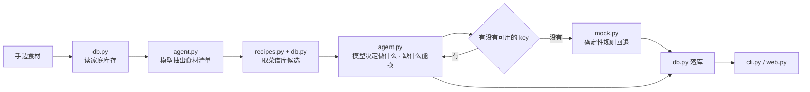

# ShiGuang SmartCook · Recipe Agent

[](https://github.com/wushiyi105-jpg/smartcook/actions) []() [](./LICENSE) [](https://codecov.io/gh/wushiyi105-jpg/smartcook)


> When you do not know what to eat, tell it what you have on hand, and the model decides "what to cook, how to cook it, what can be swapped for what is missing, and whether it is safe to eat".

A recipe app whose input is an ingredient list and whose reasoning — understand → identify → match → generate → judge — is done by the model.
**Dual CLI + Web entry points, zero third-party dependencies, works out of the box.**

## ✨ Features

- 🥘 **Order in plain speech** — "half a cabbage, two tomatoes, a bit of minced pork at home" is understood and tidied into canonical ingredients
- 🍳 **Smart recommendation** — checks the built-in recipe library and tells you which dishes are makeable, and what main ingredient each still lacks
- 📝 **Method generation** — any dish gets ingredients, steps, heat levels and tips, adjustable around your dietary restrictions
- 🔄 **Ingredient substitution** — missing a condiment or an ingredient? It proposes feasible swaps and what they change
- 🥗 **Dietary check** — peanut allergy, no spice, cutting fat… it judges up front whether this dish is safe and how to adapt it
- 🧊 **Pantry management** — record what is at home and get recommendations on demand
- 🖥 **Two entry points** — command line plus a Web UI where every step is visualised
- ⚡ **Zero dependencies** — pure Python standard library, Python 3.10+ is enough, no pip install needed

## 🚀 Quick start

```bash
git clone https://github.com/wushiyi105-jpg/smartcook.git
cd smartcook

# configure a model key (pick one)
cp .env.example .env       # edit .env and put in LLM_API_KEY
#   or: export LLM_API_KEY=your-key

# start using it
python -m smartcook suggest 家里有番茄 鸡蛋 青椒 和一点肉末
```

It talks to DeepSeek by default (the cheapest, `deepseek-flash`), creates the database on first run, and ships 20 home-style dishes.
> **⚠️ The project carries no API key of its own — put in your own** (`.env` is already gitignored and never committed).
With no key configured it falls into offline demo mode (a built-in rule engine), and the full flow still works.

## 📖 Command reference

```bash
# 🍳 suggest: recommend dishes from what is on hand
python -m smartcook suggest 番茄 鸡蛋 青椒 肉末

# 🍽 cook: full method for one dish (respects restrictions)
python -m smartcook cook 麻婆豆腐 --diet 不吃辣

# 🔄 swap: find workable substitutes for a missing ingredient
python -m smartcook swap 郫县豆瓣酱

# 🥗 diet: judge whether a dish suits a restriction or allergy
python -m smartcook diet 宫保鸡丁 --restrictions 花生过敏

# 🧊 inventory: manage pantry items
python -m smartcook inventory add 番茄 --qty 2个
python -m smartcook inventory list

# 📖 recipe library
python -m smartcook recipes            # list everything
python -m smartcook recipes 番茄炒蛋   # show one

# 🌐 Web UI (open http://127.0.0.1:8000)
python -m smartcook web --port 8000

# global options
python -m smartcook --json swap 香醋        # raw JSON output
python -m smartcook --mock suggest ...      # force offline demo (no model call)
```

## 🔌 Model backends

Works with any **OpenAI-style `/chat/completions`** endpoint, **using your own API key**; three environment variables are all it takes:

| Platform | `LLM_BASE_URL` | `LLM_MODEL` |
|---|---|---|
| DeepSeek (default) | `https://api.deepseek.com` | `deepseek-flash` |
| OpenAI | `https://api.openai.com/v1` | `gpt-4o-mini` |
| Local Ollama | `http://localhost:11434/v1` | `qwen2.5` |
| Other compatible gateway | gateway URL | gateway model name |

> `LLM_API_KEY` is required; `LLM_BASE_URL` and `LLM_MODEL` are optional.

## 🧠 How it works

The full chain behind one `suggest` call (all of it done by the model):

```
Input: "家里有半颗白菜、两个番茄、一点肉末"
   │
   ├─ ① understand / identify ── normalise colloquial ingredients into a canonical list
   │     ["番茄", "猪肉末", "白菜", ...]
   │
   ├─ ② match / judge ── check the recipe library, pick the best dishes, mark what is missing
   │
   └─ ③ generate ── output the reasoning and the missing list (feeds cook for the full method)
```

The other capabilities: `cook` (generate the method), `swap` (judge substitutions), `diet` (judge restrictions).

### Data flow

How one piece of data moves between the modules:



## 🗂 Layout

```
smartcook/
├── smartcook/
│   ├── agent.py      # core orchestration: model path + offline fallback
│   ├── llm.py        # LLM client (OpenAI-style API + .env loading + empty-response retry)
│   ├── mock.py       # offline rule engine (demo / tests only)
│   ├── db.py         # SQLite persistence layer (thread safe)
│   ├── recipes.py    # built-in recipe loading
│   ├── cli.py        # command line entry
│   ├── web.py        # Web UI (http.server + JSON API, no dependencies)
│   └── __main__.py   # python -m smartcook
├── data/seed_recipes.json      # 20 built-in home-style dishes
├── assets/demo.gif             # demo animation
├── tests/test_smartcook.py     # offline path unit tests
├── .github/workflows/test.yml  # CI
├── .env.example
└── README.md
```

## ✅ Tests

Locally:

```bash
python -m unittest discover tests -v
```

Every push / PR runs the same suite on GitHub Actions across Python 3.10 / 3.11 / 3.12; see the `test` badge at the top.

## 👤 Author

- Name: shiyi
- Email: [wushiyi105@gmail.com](mailto:wushiyi105@gmail.com)
- Phone: 18384198104
- GitHub: [@wushiyi105-jpg](https://github.com/wushiyi105-jpg)

## 📄 License

[MIT](./LICENSE)
