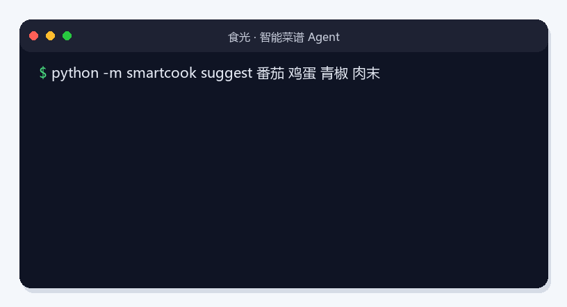
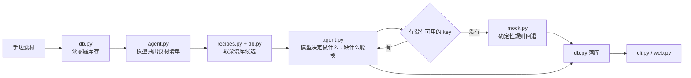

# 食光 ShiGuang · 智能菜谱 Agent

[](https://github.com/wushiyi105-jpg/smartcook/actions) []() [](./LICENSE) [](https://codecov.io/gh/wushiyi105-jpg/smartcook)



> 不知道吃什么的时候,告诉它你手边有什么,大模型帮你决定「做什么、怎么做、缺什么能换、能不能吃」。

一个输入食材清单、由大模型完成「理解 → 识别 → 匹配 → 生成 → 判断」的智能菜谱应用。
**CLI + Web 双入口,零第三方依赖,开箱即用。**

## ✨ 特性

- 🥘 **说人话点菜** —— 「家里有半颗白菜、两个番茄、一点肉末」也能听懂,自动整理成规范食材
- 🍳 **智能推荐** —— 对照内置菜谱库,告诉你哪道能做、还缺什么主料
- 📝 **做法生成** —— 任意一道菜都能给出用料、步骤、火候、贴士,还能结合忌口个性化调整
- 🔄 **食材替代** —— 缺某样调料/食材?给出可行的替代方案和影响
- 🥗 **忌口判断** —— 花生过敏、不吃辣、减脂……提前判断这道菜能不能吃、怎么改
- 🧊 **库存管理** —— 记录家中食材,随时推荐可做的菜
- 🖥 **双入口** —— 命令行 + 网页界面(网页里每一步都可视化)
- ⚡ **零依赖** —— 纯 Python 标准库,Python 3.10+ 即可运行,无需 pip install

## 🚀 快速开始

```bash
git clone https://github.com/wushiyi105-jpg/smartcook.git
cd smartcook

# 配置模型 key(二选一)
cp .env.example .env       # 编辑 .env 填入 LLM_API_KEY
#   或 export LLM_API_KEY=你的key

# 直接开用
python -m smartcook suggest 家里有番茄 鸡蛋 青椒 和一点肉末
```

默认对接 DeepSeek(最便宜的 `deepseek-flash`),首次运行自动建库并内置 20 道家常菜。
> **⚠️ 项目不自带任何 API key,请填入你自己的 key**(`.env` 已 gitignore,不会提交)。
未配置 key 时自动进入离线模式(内置规则引擎兜底),也能跑通全流程。

Docker 运行:

```bash
docker build -t smartcook .
docker run -p 8000:8000 smartcook
```

## 🤔 为什么不用通用大模型直接问

通用对话模型能写出一份像样的「番茄炒蛋」做法,但食光补的是它做不到的四件事:

1. **结果可复现** —— 菜谱库、库存、缺料清单都在本机,模型给出的菜名会被强制对齐到内置菜谱(「西红柿炒蛋」和「番茄炒蛋」不会变成两道菜);加 `--mock` 时整条链路是确定性的,同一批食材问两次得到同一份清单,可以写进测试。
2. **数据留在本地** —— 家里有什么、谁不能吃花生、推荐过哪些菜,都存在 `data/smartcook.db`;只有这一次输入的食材文本会发给模型,库存与忌口不往云端同步。
3. **离线可用** —— 没配 key 自动进入离线模式,食材归一化、菜谱匹配、替代与忌口判断由内置规则照做,内置 20 道菜不受影响;通用对话离线就断。
4. **结构化输出** —— 每个命令返回固定字段(能做的菜、缺失主料、替代方案、忌口结论),`--json` 可以直接喂给别的程序,CLI 与 Web 共用同一份结果;通用对话给你一段散文,还得自己再解析。

## 🎯 适用场景

- **下班回家、对着冰箱没主意**:把「半颗白菜、两个番茄、一点肉末」原话丢给 `suggest`,拿回 2 到 5 道能做的菜和每道还缺的那一样主料;缺太多就说明今天该买菜了,不用一道一道翻菜谱。
- **家里有人过敏或忌口**:先用 `diet` 判断这道菜能不能吃、风险在哪一步,再让 `cook --diet 不吃辣` 把做法里的辣椒处理掉,缺调料时用 `swap` 找替代并看清会影响什么味道。
- **一个人做饭、不想买重复**:用 `inventory` 记着现有食材,`suggest` 会优先用已有的;新买的东西随手记进去,几天后再问一次,免得同一样菜买两轮放到坏。

## 🗺 Roadmap

- **库存数量联动**:`cook` 做完按用量扣减 `inventory` 里的数量,现在只记「有/没有」,不做减法。
- **一键采购清单**:把 `suggest` 结果里各道菜缺的食材合并去重成一张清单,拿着直接去买。
- **菜谱库导入导出**:支持把自家常做的菜按 JSON 批量导入,替换或补充内置的 20 道,并支持导出备份。
- **步骤计时器**:Web 里给炖、蒸、醒面这类需要等待的步骤挂倒计时,不用另开手机。
- **同一道菜的多轮追问**:连着问「盐放多了怎么救」「能不能用空气炸锅」,保留上下文,而不是每次重新开始。

## ❓ FAQ

**API key 从哪来?**
项目不自带 key。默认接 DeepSeek(`https://api.deepseek.com`),去 DeepSeek 开放平台注册后创建 key,填进 `.env` 的 `LLM_API_KEY`,或 `export LLM_API_KEY=你的key`。任何 OpenAI 风格 `/chat/completions` 服务都能用,本地 Ollama 也行,地址与模型名见上一节表格。

**数据存在哪,会不会上传?**
默认 `data/smartcook.db`(单个 SQLite 文件),可用 `SMARTCOOK_DB` 换路径。库存、菜谱、历史记录都留在本机;调用模型时只发送你这一次输入的食材或菜名文本,不发整个库。

**没有 key 还能用吗?**
能,自动进离线模式:归一化、匹配、替代、忌口都由规则给出,覆盖内置 20 道菜。离线时未收录的菜会直接说明「库里没有」,不会编一个做法出来;想要任意菜的做法才需要配 key。

**怎么换模型?**
改三个环境变量:`LLM_BASE_URL`、`LLM_MODEL`、`LLM_API_KEY`,不用改代码;也可以临时用 `--model` 覆盖。

**为什么两次推荐结果不完全一样?**
模型那一步有采样,措辞会变,推荐顺序也可能换;但菜名会被强制对齐到本地菜谱,缺料以库里的食材表为准。想要完全稳定就加 `--mock`,整条链路走规则,结果可复算。

## 📖 命令参考

```bash
# 🍳 推荐:根据手边食材推荐能做的菜
python -m smartcook suggest 番茄 鸡蛋 青椒 肉末

# 🍽 做法:生成某道菜的完整做法(可结合忌口)
python -m smartcook cook 麻婆豆腐 --diet 不吃辣

# 🔄 替代:缺某食材,找可行替代品
python -m smartcook swap 郫县豆瓣酱

# 🥗 忌口:判断某道菜是否适合某忌口/过敏
python -m smartcook diet 宫保鸡丁 --restrictions 花生过敏

# 🧊 库存:管理家中食材
python -m smartcook inventory add 番茄 --qty 2个
python -m smartcook inventory list

# 📖 菜谱库
python -m smartcook recipes            # 列出全部
python -m smartcook recipes 番茄炒蛋   # 查看单道

# 🌐 Web 界面(浏览器打开 http://127.0.0.1:8000)
python -m smartcook web --port 8000

# 全局选项
python -m smartcook --json swap 香醋        # 输出原始 JSON
python -m smartcook --mock suggest ...      # 强制离线模式(不调用模型)
```

## 🔌 模型接入

兼容任意 **OpenAI 风格 `/chat/completions`** 接口,**使用你自己的 API key**,改三个环境变量即可:

| 平台 | `LLM_BASE_URL` | `LLM_MODEL` |
|---|---|---|
| DeepSeek(默认) | `https://api.deepseek.com` | `deepseek-flash` |
| OpenAI | `https://api.openai.com/v1` | `gpt-4o-mini` |
| 本地 Ollama | `http://localhost:11434/v1` | `qwen2.5` |
| 其他兼容网关 | 网关地址 | 网关模型名 |

> `LLM_API_KEY` 必填;`LLM_BASE_URL`、`LLM_MODEL` 选填。

## 🧠 工作原理

一次 `suggest` 的完整链路(全部由模型完成):

```
输入:「家里有半颗白菜、两个番茄、一点肉末」
   │
   ├─ ① 理解/识别 ── 把口语食材归一化为规范清单
   │     ["番茄", "猪肉末", "白菜", ...]
   │
   ├─ ② 匹配/判断 ── 对照菜谱库,选出最合适的菜,标出缺什么
   │
   └─ ③ 生成 ── 输出推荐理由与缺失清单(联动 cook 生成完整做法)
```

其余能力:`cook`(生成做法)、`swap`(判断替代)、`diet`(判断忌口)。

### 数据流

一条数据在这几个模块之间怎么走：



## 🗂 目录结构

```
smartcook/
├── smartcook/
│   ├── agent.py      # 核心编排:模型主路径 + 离线回退
│   ├── llm.py        # LLM 客户端(OpenAI 风格接口 + .env 加载 + 空响应重试)
│   ├── mock.py       # 离线规则引擎(兜底/测试)
│   ├── db.py         # SQLite 持久层(线程安全)
│   ├── recipes.py    # 内置菜谱加载
│   ├── cli.py        # 命令行入口
│   ├── web.py        # Web 界面(零依赖 http.server + JSON API)
│   └── __main__.py   # python -m smartcook
├── data/seed_recipes.json      # 20 道内置家常菜
├── assets/demo.gif             # 演示动图
├── tests/test_smartcook.py     # 离线路径单元测试
├── .github/workflows/test.yml  # CI
├── .env.example
└── README.md
```

## ✅ 测试

本地:

```bash
python -m unittest discover tests -v
```

每次 push / PR 由 GitHub Actions 在 Python 3.10 / 3.11 / 3.12 上自动跑同一组测试,结果见顶部 `test` 徽章。

## 👤 作者

- 署名：shiyi
- 邮箱:[wushiyi105@gmail.com](mailto:wushiyi105@gmail.com)
- 电话:18384198104
- GitHub:[@wushiyi105-jpg](https://github.com/wushiyi105-jpg)

## 📄 License

[MIT](./LICENSE)
